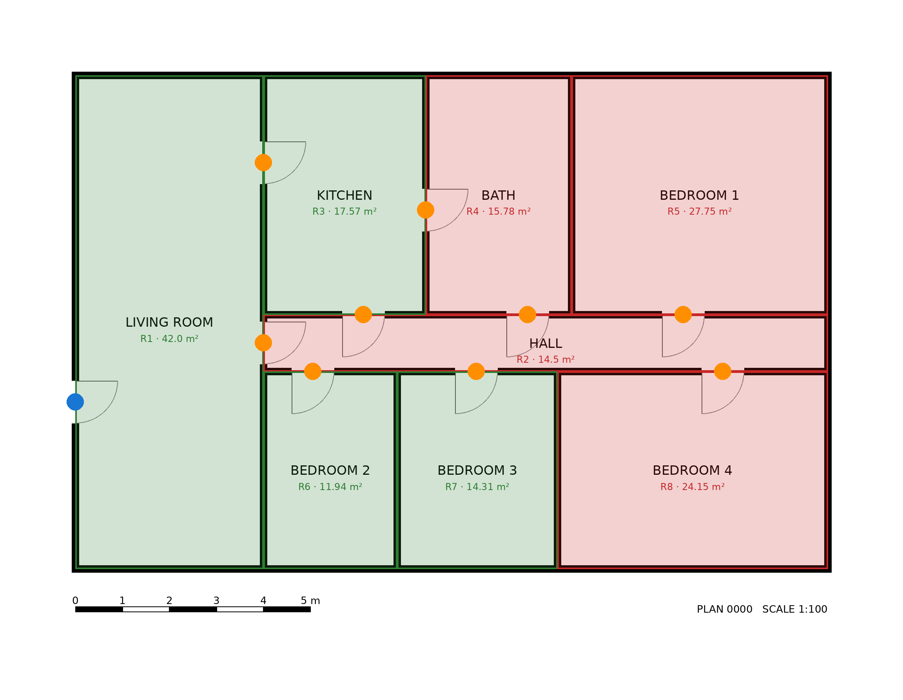
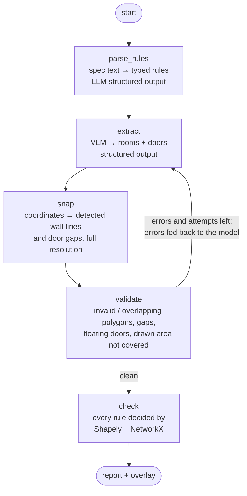

# PlanCheck: agentic floor-plan compliance checking

PlanCheck reads an architectural floor plan image and checks it against a written specification
("every bedroom ≥ 9 m²", "a bathroom must not open into a kitchen", "no point more than 15 m from an exit").

The core idea: **the vision-language model reads the drawing, but exact geometry decides the rules.**
VLMs are good at recognising rooms, labels and doors, and bad at precise coordinates and arithmetic.
So the model's answer is treated as a draft that is snapped, validated and repaired, and every verdict comes
from Shapely and NetworkX in metres, with the failing rooms and distances shown in the report.


*Red rooms fail at least one rule, blue dot = exit, orange = interior doors. Full report: [docs/example/plan_0000.md](docs/example/plan_0000.md).*

## How it works



The workflow is a [LangGraph](https://github.com/langchain-ai/langgraph) `StateGraph` (`plancheck/agent.py`):

| Step | What happens | Code |
|---|---|---|
| parse_rules | A written spec (`data/rules/*.txt`) is turned into typed rules with structured output, or a YAML rule file is loaded. | `parse_rules.py`, `rules.py` |
| extract | Any LangChain chat model with vision (`anthropic:…`, `openai:…`, `google_genai:…`) returns rooms (polygons on wall centrelines) and doors as JSON matching a Pydantic schema. The image is downscaled to the model's input size and coordinates are scaled back. | `extract.py` |
| snap | Walls are long, thick, dark strokes, so their centrelines are detected exactly in the full-resolution image. Each room edge moves to the wall line actually drawn along it, and each door to the centre of the drawn gap. The model keeps the topology; the pixels give the precision. | `snap.py` |
| validate | Exact checks: invalid or tiny polygons, overlaps, holes between rooms, doors not on a wall, and drawn floor area that no room covers (catches skipped rooms on the outer edge). Errors go back to the model with its previous answer for a repair, up to `--max-attempts`. | `geometry.py`, `snap.py` |
| check | Areas, minimum widths, shared walls (≥ 0.8 m of contact), which rooms each door connects (derived geometrically, not trusted from the model), and worst-case walking distance to an exit: geodesic paths inside each room (correct for L-shaped rooms) chained door to door with Dijkstra. | `geometry.py`, `rules.py` |

Rule kinds: `min_area`, `min_width`, `adjacent`, `door_between`, `no_door_between`, `max_egress`,
`every_room_has_door`, `requires_room`.

## Quick start

```bash
python -m venv .venv && source .venv/bin/activate
pip install -e ".[dev,anthropic,openai]"

plancheck synth --n 30                         # 30 labelled synthetic plans in data/plans
plancheck check data/plans/plan_0000.png       # offline, with the simulated extractor
pytest -q                                      # 16 tests, no API key needed
```

With a real model:

```bash
export ANTHROPIC_API_KEY=...    # or OPENAI_API_KEY / GOOGLE_API_KEY
plancheck check data/plans/plan_0000.png --model anthropic:claude-sonnet-5-5

# let the LLM read the written spec too
plancheck check data/plans/plan_0000.png --model anthropic:claude-sonnet-5-5 --rules data/rules/residential.txt

# your own drawing: give the scale in pixels per metre
plancheck check my_plan.png --model openai:gpt-5 --px-per-m 85
```

Outputs go to `reports/`: a Markdown report, a JSON file with every measurement, and an overlay image.

## Evaluation

`plancheck eval` runs the whole pipeline on the labelled set and compares models:

```bash
plancheck eval --models anthropic:claude-sonnet-5-5 openai:gpt-5 simulated --limit 30
```

| Metric | Meaning |
|---|---|
| Rule acc. | Share of pass/fail verdicts that match the verdicts computed on the ground truth |
| Plans fully right | Share of plans with every verdict right |
| Room F1, mean IoU | Rooms matched to ground truth at IoU ≥ 0.5 |
| Type acc., area err. | Among matched rooms |
| Door recall | Ground-truth doors with an extracted door within 0.3 m |
| Attempts, sec, tokens, $ | Per plan; fill `prices.yaml` for cost |

Ground truth comes from the synthetic generator (`plancheck/synth.py`): random apartments drawn at
120 px/m (≈2300 × 1800 px), with the true polygons and doors saved next to each image. About half the
plans break at least one rule on purpose (small bedrooms, bathroom opening into the kitchen, long
escape routes).

Pipeline ablation with the simulated extractor (VLM-like noise and skipped rooms, **not a real model**):

| Pipeline | Rule acc. | Plans fully right | Area err. | Attempts |
|---|---|---|---|---|
| with wall snapping | 100.0% | 100.0% | 0.2% | 1.33 |
| without wall snapping | 80.4% | 26.7% | 4.4% | 2.97 |

Details: [docs/results_simulated_snap.md](docs/results_simulated_snap.md). Real-model results: run the
command above with your API keys and add the table here.

## Project layout

```
plancheck/
  schema.py        Pydantic models: internal plan + the provider-portable "wire" schema the model fills
  extract.py       VLMExtractor (any LangChain vision model) and SimulatedExtractor (offline test double)
  snap.py          wall-line detection, edge/door snapping, uncovered-area detection
  geometry.py      Shapely/NetworkX measurements and validation
  rules.py         typed rules and their checks
  parse_rules.py   written spec → rules with an LLM
  agent.py         LangGraph workflow with the repair loop
  evaluate.py      metrics and model comparison
  report.py        Markdown report and overlay image
  synth.py         synthetic plans with ground truth
  cli.py           plancheck synth | check | eval
data/rules/        example specification (.txt) and its typed version (.yaml)
tests/             geometry, rules, snapping, repair loop, model code path (stubbed)
```

## Limitations and next steps

- Snapping assumes axis-aligned walls; angled walls keep the model's coordinates. Next: Hough-line detection for any angle.
- Very large sheets (A0 at high DPI): tile the image and merge per-tile extractions before snapping.
- Real drawings: evaluate on CubiCasa5k (5,000 annotated plans) in addition to the synthetic set.
- The scale is given by the user (`--px-per-m`); reading it from the scale bar or dimension lines is a natural next tool for the agent.
- Doors are points; door width rules (e.g. ≥ 0.8 m clear opening) need the gap width, which `snap.py` already measures.
